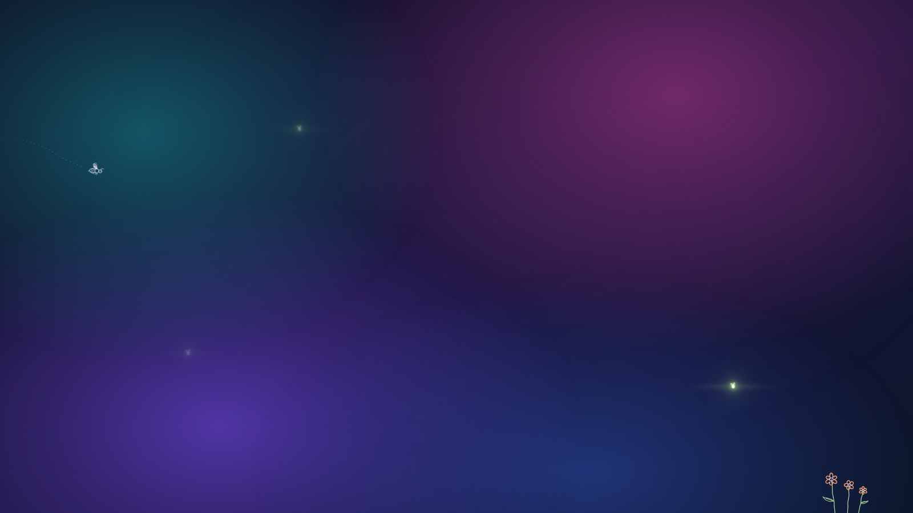
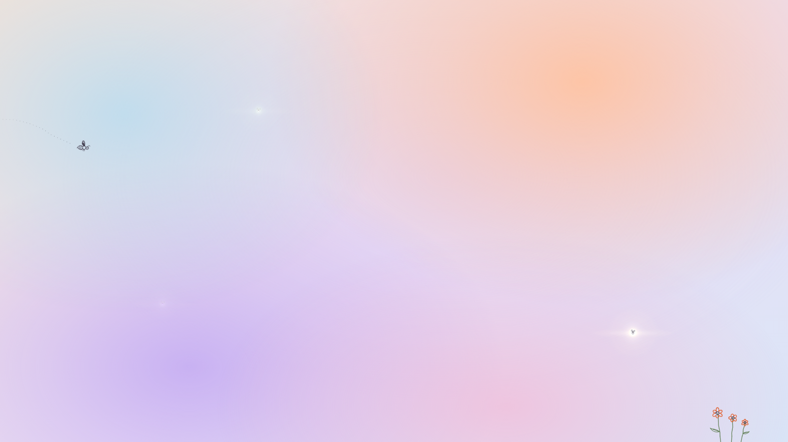

# Dusk Glass

A theme for the Claude desktop app: lavender-dusk colours on every surface, and a living dusk
sky behind the conversation. Fireflies glow up one or two at a time and fade as they wander, a
little pen-drawn bee wanders the whole screen with a fading dotted trail, and three pen-drawn
flowers grow up out of the window's bottom-right corner, bending when a breeze passes. Light and
dark mode each get their own palette.

Optionally the conversation is drawn in **Comic Sans** (on by default). It uses the theme's own
`style` option, so the words are still the app's real text: selecting, copying, find and screen
readers keep working.





*The sky alone, rendered at 1600×900; in the app it sits behind the conversation and moves.*

## Install

At the prompt of a Claude Code terminal session:

```
/plugin install dusk-glass --marketplace bmconsult/dusk-glass
```

From a shell:

```
claude plugin install dusk-glass --marketplace bmconsult/dusk-glass
```

In the desktop app, where `/plugin` does not run: click **+** next to the prompt box, then
**Plugins**, **Add marketplace** with `bmconsult/dusk-glass`, then **Add plugin**.

## Options

| Option | Values | Default |
| --- | --- | --- |
| `font` (Chat font) | `comic-sans`, `app-default` | `comic-sans` |

Change it from the plugin's settings (`/config` in a terminal session).

## Notes

- **Comic Sans is Windows-only.** The theme asks for the generic `cursive` font, which Chromium
  draws as Comic Sans MS on Windows. macOS and Linux show their own cursive font instead; set
  `font` to `app-default` if you don't like it.
- Your accessibility font setting wins over the theme's font, as the app intends.
- The theme needs a desktop app recent enough to take a theme `style`. On an older one the
  colours and sky still apply and the font stays the app's own.
- The sky is a single SVG kept light enough for the app's backdrop player, which pauses a
  backdrop that is too expensive to draw.

## Files

- `hooks/register.tsx`: sets the theme and draws the backdrop.
- `hooks/scene.ts`, `hooks/flowers.ts`: the sky and the corner flowers (generated SVG).
- `hooks/palette.ts`: the colours.
- `hooks/make-colors.js`: the colour helper from Claude Code's mod kit, unchanged.

## License

MIT
